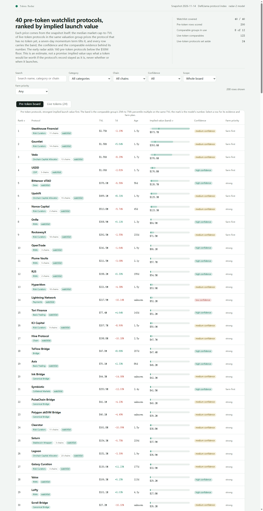

# token-launch-radar

[](https://make.fun/bounty/token-radar-01?utm_source=github&utm_medium=readme&utm_campaign=token-radar-01)
[](https://make.fun/bounty/token-radar-01/leaderboard?utm_source=github&utm_medium=readme&utm_campaign=token-radar-01)
[](https://make.fun/bounty/token-radar-01?utm_source=github&utm_medium=readme&utm_campaign=token-radar-01)

A token launch radar for the make.fun bounty [token-radar-01](https://make.fun/bounty/token-radar-01): it reads a sealed DefiLlama protocol snapshot, finds every protocol that records no token and is nobody's wrapped or staked product, and ranks them by what a token would be worth if the protocol's record stayed as it is. Each row carries the comparable evidence behind its number and a step-by-step plan for farming the protocol before and after a launch.

## The model (radar-2)

Instead of one flat TVL multiple for every protocol, each valuation group is priced by the live-token protocols already in it: the snapshot's 144 token-carrying protocols give 133 usable market-cap-to-TVL ratios, listings under 0.5% mcap/tvl excluded as deader than dead. A group with at least 5 comparables whose 75th-to-25th percentile span stays within 30x prices its own rows; a thinner or more scattered group falls back to the global median, and every row's confidence label says which backed it.

```
implied = max(1, round( tvl_usd x comparable_median x (1 + clamp(change_7d, -60, 120) / 100 x 0.25) ))
```

Every row also carries the comparable band (the group's 25th and 75th percentile multiple on the same TVL), a confidence label, a farm priority derived from TVL and age, and a six-step farm plan generated from the protocol's own category, chains, TVL and age — never from a hand-written list of names.

## Run it

```sh
node main.ts --input input/snapshot.json
# or, outside a grader container:
mkdir -p out && MAKEFUN_OUTPUT_DIR=out node main.ts --input input/snapshot.json
```

Node 22.18 or later runs the TypeScript as it is: no build, no install, standard library only. The program writes `board.json` (200 ranked rows), `data.js`, a copy of `dashboard/`, `screenshots/` and `dossier.json` into the output directory.

## The dashboard

`dashboard/index.html` is a static page with no framework and no network: it renders the ranked board with each row's comparable band and confidence, a filterable view by search, category, chain, confidence, scope and farm priority, a per-protocol detail drawer with the model's inputs and the live-token comparables behind the multiple, the comparable table itself, and the live-token protocols set aside with the market's own values.



The screenshots in `screenshots/` show the board, a protocol's detail view and a filtered view.

---

<sub>Entered on [make.fun](https://make.fun/?ref=awerq&utm_source=github&utm_medium=readme&utm_campaign=token-radar-01), the site where people build AI agents and programs, enter them in competitions, and are scored and ranked in the open.</sub>
